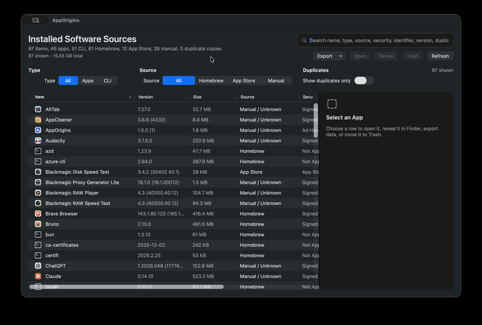

# AppOrigins [](https://visitorbadge.io/status?path=https%3A%2F%2Fgithub.com%2Fusmslm102%2Fmac-app-origins)


## Release:

[](https://github.com/usmslm102/mac-app-origins/releases)


AppOrigins is a native macOS SwiftUI utility for inspecting installed software and where it came from.

It scans your installed apps and Homebrew packages, then surfaces:

- source: `Homebrew`, `App Store`, or `Manual / Unknown`
- install type: app bundle or CLI tool
- version
- size
- duplicate installs
- signing status
- path and bundle identifier

## Demo



## Project website

The static showcase lives in `site/` and is deployed to
[GitHub Pages](https://usamaansari.com/mac-app-origins/) by
`.github/workflows/pages.yml`. Changes to the site, demo, or packaging script
deploy automatically on `main`; pull requests build the site without deploying.
The workflow can also be run manually from the Actions tab.

In the repository’s **Settings → Pages**, select **GitHub Actions** as the build
and deployment source before the first deployment.

Preview locally without installing dependencies:

```bash
bash scripts/prepare-pages.sh
python3 -m http.server 8000 --directory .pages-dist
```

Open `http://localhost:8000`. The build reuses `demo/demo.gif` and packages only
the public site into the ignored `.pages-dist/` directory. Download buttons link
directly to `AppOrigins.dmg` on the latest GitHub release, so publishing a new
release updates the download without changing the site.

## Features

- Scan `/Applications` and `~/Applications`
- Optional external-volume scanning (`/Volumes/*/Applications`, opt-in)
- Detect Homebrew casks and formulae
- Detect App Store installs when possible
- Show version, size, source, location, security status, bundle ID, and path
- Sort by item, version, size, source, security status, type, and duplicates
- Search across name, source, location, security status, version, duplicate status, size, bundle ID, and path
- Filter by install type and source tabs
- Filter to external installs only
- Choose quick refresh (cached metadata) or full rescan
- Show total size for the current filtered result set
- See overall app and CLI sizes at a glance, with a breakdown by source, install type, and internal or external storage
- Detect duplicate installed app copies and filter to duplicates only
- Open apps, reveal them in Finder, open locations in Terminal, copy path/identifier, or move app bundles to Trash
- Export the current view as CSV or JSON
- Review Scan Activity: added items, items no longer found, and before/after changes to versions, sources, and signing status
- Keep the previous scan locally across launches and export activity as JSON
- Check GitHub for app updates and show an **Update Available** button when a newer stable release is available

### Overall Sizes

The size overview above the filters shows the combined size of every scanned
install, plus separate totals for apps and CLI tools. Choose **Size Breakdown**
to see totals by source, install type, and internal or external storage. These
totals stay tied to the full scan when you search or filter; the bottom bar shows
the size of the current results.

Sizes cover scanned app bundles and Homebrew formula folders, including each
installed copy. They do not include app support files or all used disk space.
Items with unknown sizes are counted and excluded from byte totals. Refreshing
updates the overview when the scan completes.

### Scan Activity

Open **Scan Activity** from the toolbar or press **⇧⌘H**. The first completed
scan saves a baseline on your Mac. Subsequent scans compare against the previous
completed scan, including after reopening AppOrigins. Filter activity by change
type, search by name or path, or choose **Show Item** to select it in the inventory.

Changing scan locations establishes a new baseline. Copies at different paths
are tracked separately, and size fluctuations do not count as changes. “No longer
found” can mean an item was moved, a volume disconnected, or detection became
unavailable; it does not confirm an uninstall. Activity reflects only the latest
comparison, rather than a permanent event log.

Use **⌘R** for a quick refresh and **⇧⌘R** for a full rescan, or choose either
from the Refresh menu. Full rescans recalculate metadata and reload app icons.

### App Updates

AppOrigins checks its public GitHub releases when the app opens or becomes active,
at most once every 24 hours. A newer stable release adds
an **Update Available** button to the toolbar. It opens that release’s notes and
download page. **Settings → Updates** also offers a direct **Download DMG** button
when the release has a completed `AppOrigins.dmg` upload.

Use **AppOrigins → Check for Updates…** for an immediate check, or turn automatic
checks off in **Settings → Updates**. Downloads and installation are started by
the user. A previously discovered update remains available if a later check fails.

The installed version comes from the packaged app’s `CFBundleShortVersionString`.
The release workflow sets it from the Git tag; local bundles can set it with
`APP_VERSION` when packaging. Bare `swift run` development builds have no app-bundle
version, so they offer a GitHub releases link instead of guessing whether they
need an update. No GitHub account or token is required.

## Requirements

- macOS 13 or later
- Xcode or Swift Package Manager

Run the regression tests with:

```bash
swift test
```

Optional tools:

- `brew` for richer Homebrew detection
- `mas` for richer App Store detection

The app still works without these tools, but related detections will be unavailable and some items may fall back to `Manual / Unknown`.

## Quick Start

Clone the repo and run it locally:

```bash
git clone https://github.com/<your-account>/AppOrigins.git
cd AppOrigins
swift run
```

## Open in Xcode

1. Open Xcode.
2. Choose `File > Open...`.
3. Select `Package.swift`.
4. Run the `AppOrigins` scheme.

## Build a DMG

Build a community DMG without an Apple Developer account:

```bash
./package-dmg.sh
```

That produces `AppOrigins.dmg` in the repo root.

You can override the version metadata if needed:

```bash
APP_VERSION=1.0.0 BUILD_NUMBER=1 BUNDLE_IDENTIFIER=com.example.AppOrigins ./package-dmg.sh
```

## GitHub Release Workflow

This repo includes a community release workflow at `.github/workflows/release-unsigned.yml`.
It does not require an Apple Developer account, Developer ID certificate, or
notarization credentials.

Push a version tag:

```bash
git tag v0.1.0
git push origin v0.1.0
```

The workflow will:

- build `AppOrigins.dmg`
- generate a SHA-256 checksum and verify the app signature inside the finished DMG
- create or update the GitHub release for that tag

## Unsigned Build Warning

The generated app bundle is ad-hoc signed after assembly so its metadata and
resources have a valid signature. It is not Developer ID signed or notarized.
The release workflow verifies the app signature inside the finished DMG before
publishing it. Ad-hoc signing does not establish Apple-verified developer trust,
so macOS can still block a quarantined download.

After downloading from this repository's release page, copy the app to
`/Applications` and try opening it. If macOS blocks the unidentified developer,
open **System Settings → Privacy & Security → Open Anyway**, then confirm **Open**.
This creates an exception for this app; see [Apple's instructions](https://support.apple.com/en-us/102445).
If the app is reported as damaged, download the latest corrected release rather
than overriding that alert. Packaging signature checks also run on pull requests
through `.github/workflows/package.yml`.

## Detection Details

- `brew list --cask` is used to build the Homebrew app list
- `brew list --formula` is used to enumerate Homebrew CLI tools
- `mas list` is used when `mas` is installed
- `Contents/_MASReceipt/receipt` is checked directly as an App Store fallback, including on volumes without Spotlight indexing
- `codesign -dv --verbose=4` is used to classify apps as `Signed`, `Ad Hoc`, or `Unsigned`
- recursive bundle or cellar folder size is calculated locally for each scanned item
- quick-refresh metadata is invalidated when bundle metadata, signing resources, receipts, or detected source change

## Notes and Limitations

- `Move to Trash` only moves the `.app` bundle. It does not remove support files from `~/Library`.
- External-volume scanning is opt-in and currently scans known app folders (`/Volumes/*/Applications`) only.
- The security column currently reflects signing state and App Store provenance. It does not perform standalone notarization verification yet.
- Duplicate detection is currently focused on app bundles, using bundle identifier first and normalized app name as a fallback.
- Homebrew and App Store matching are heuristic in some cases.
- The repo icon lives at `assets/apporigins-icon.svg`, and the app bundle icon lives at `assets/AppOrigins.icns`.
